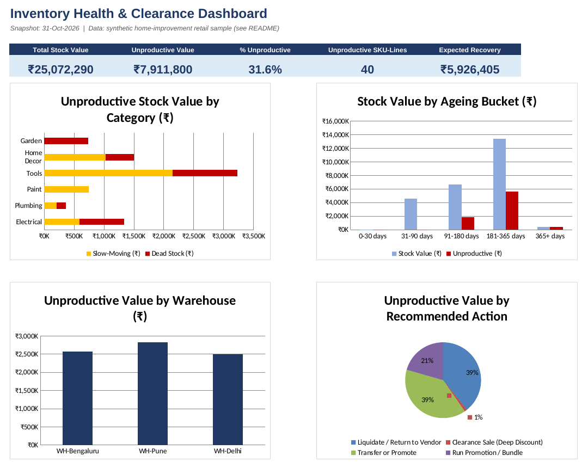

# Inventory Ageing & Clearance Tracker (Excel)

An Excel project that finds **unproductive inventory** (slow-moving and dead stock) across multiple warehouses, measures how much money is stuck in it, and builds a **clearance plan with owners for daily follow-up**.

## Key results (sample data)
| Metric | Value |
|---|---|
| Total stock value | ₹2.51 crore |
| Unproductive stock value | ₹79.1 lakh (31.6%) |
| Unproductive SKU-warehouse lines | 40 |
| Expected recovery after clearance | ₹59.3 lakh |

- **Tools** has the highest unproductive value (₹32.3 lakh), so it is the first category to target.
- Most unproductive stock has been held for **181–365 days**.
- About ₹31 lakh of dead stock is large enough to **liquidate or return to the vendor**.

## Data
This is a **synthetic sample dataset** (not real company data), modelled on a home-improvement retailer: 72 SKUs, 6 categories, 3 warehouses (Bengaluru, Pune, Delhi), 146 SKU-warehouse lines. The raw sheet is intentionally messy (extra spaces, lower-case SKU codes, blank sale dates) for data-cleaning practice.

## How the workbook works
| Sheet | What it does | Excel skills |
|---|---|---|
| Settings | Snapshot date, ageing thresholds, discount assumptions (editable) | Input cells, data-driven logic |
| Raw_Inventory | Stock export as pulled from the system | – |
| SKU_Master | Product, category, vendor, unit cost | – |
| Clean_Data | Cleans SKU codes, pulls master data, calculates stock value, days in stock, days since last sale, ageing bucket, status and recommended action | TRIM, UPPER, VLOOKUP, nested IF, IFERROR, conditional formatting, filters |
| Summary | Totals by category, ageing bucket, warehouse and action | SUMIFS, COUNTIFS |
| Top_15_Unproductive | Priority list by value with owner and follow-up status | LARGE, INDEX/MATCH, data validation dropdowns |
| Dashboard | KPIs and charts for a leadership review | Charts, KPI cards |

## Business rules
- **Healthy:** sold within the last 90 days
- **Slow-Moving:** no sale for 91–180 days
- **Dead Stock:** no sale for 180+ days, or never sold and in stock for 90+ days
- **Actions:** dead stock worth ₹50K+ → liquidate / return to vendor; smaller dead stock → clearance sale; slow-moving → promotion, bundle or transfer to another warehouse
- **Expected recovery** = stock value × (1 − assumed clearance discount)

All thresholds can be changed in the **Settings** sheet, and every sheet updates.

## Author
Bipin Kumar · [LinkedIn](https://www.linkedin.com/in/bipinkumar11/) · [Portfolio](https://bipinyadav11.edgeone.app/)
